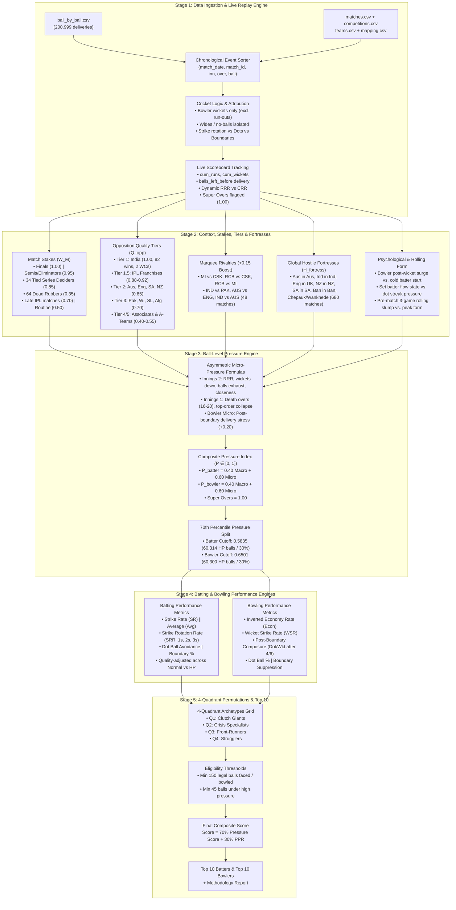

# 🏏 SupeRR Selector Season 2 — Reliability Under Pressure Engine

> **Round 1 Solution Architecture & Methodology**  
> An empirical, multi-layer analytics system to evaluate, segment, and rank the most reliable T20/T20I batters and bowlers under high-pressure conditions.

---

## 📌 Executive Summary

Cricket analysis often relies on crude averages or reputation to judge "clutch" players. This system builds a **ball-level data-driven pressure engine** across **200,999 deliveries** (867 matches, Jan 2022 – Nov 2026) covering both the Indian Premier League (IPL) and International T20s (T20Is).

### The Core Methodology:
1. **Dynamic State Reconstruction**: Transform static CSV records into a chronological, live game simulation with real-time scoreboards, dynamic Required Run Rate (RRR), balls left before delivery, and wickets fallen.
2. **Context & Stakes Modeling**: Calibrate match stakes ($W_M$), opposition quality tiers ($Q_{\text{opp}}$), marquee high-ego rivalries (El Clásico boost), and hostile global fortresses / backyard crowds ($H_{\text{fortress}}$).
3. **Psychological & Form Dynamics**: Factor in bowler post-wicket dominance vs. cold incoming batters, in-game settling flow states, and pre-match 3-game rolling form.
4. **Asymmetric Pressure Modeling**: Calculate distinct pressure scores for batters ($P_{\text{batter}}$) and bowlers ($P_{\text{bowler}}$) on every ball, executing a 70th-percentile pressure split.
5. **4-Quadrant Permutations Model**: Map qualified players into four archetypes:
   - **Quadrant 1: Clutch Giants** (High Normal, High Pressure)
   - **Quadrant 2: Crisis Specialists** (Low/Mid Normal, High Pressure)
   - **Quadrant 3: Front-Runners** (High Normal, Low Pressure)
   - **Quadrant 4: Strugglers** (Low Normal, Low Pressure)
6. **Final Ranking**: A composite score blending absolute pressure performance ($70\%$) with relative elevation over personal baseline (PPR, $30\%$).

---

## 🔄 End-to-End Pipeline Architecture



---

## 🗂️ File Inventory & Directory Structure

```
superr_selector/
├── README.md                           # Master Architecture Documentation (this file)
├── METHODOLOGY_REPORT.md               # Official Competition Methodology Report (Unstop ready)
├── ball_by_ball.csv                    # Raw delivery records (200,999 rows)
├── matches.csv                         # Raw match metadata (883 rows)
├── competitions.csv                    # Competition & format index (141 rows)
├── teams.csv                           # Team definitions (353 rows)
├── playing_eleven.csv                  # Squad lineups & role flags (28,381 rows)
├── competition_team_player_mapping.csv # Player index (6,413 rows)
├── enriched_ball_by_ball.parquet       # Master enriched dataset (116 columns, 0 NaNs)
├── ingest_and_enrich.py                # Stage 1: Data ingestion & state reconstruction
├── enhanced_stage2.py                  # Stage 2: Stakes, rivalries & global fortresses
├── add_player_form_and_confidence.py   # Stage 2B: Psychological & rolling form layer
├── stage3_pressure_engine.py           # Stage 3: Ball-level pressure index & split
├── stage4_performance_engine.py        # Stage 4: Batting & bowling performance metrics
├── positional_analysis.py              # Stage 4B: Positional batters (1-7) & phase specialists
├── stage5_quadrants_and_rankings.py    # Stage 5: 4-Quadrant model & final Top-10 lists
├── audit_stages_1_to_4.py              # Multi-point automated integrity audit suite
├── top10_batters.csv                   # Official Top 10 Batters under pressure
├── top10_bowlers.csv                   # Official Top 10 Bowlers under pressure
├── batter_quadrants.csv                # 4-Quadrant segmentation for all 162 qualified batters
├── bowler_quadrants.csv                # 4-Quadrant segmentation for all 243 qualified bowlers
├── positional_batters.csv              # Best batters by batting order position (Slots 1 to 7)
├── bowling_phase_specialists.csv       # Best bowlers by match phase (Powerplay, Middle, Death)
└── pressure_proof_xi.json              # The ultimate Pressure-Proof World XI lineup
```

---

## 🔬 Mathematical Formulas & Methodological Grounding

### 1. Macro Context Factor ($C_{\text{macro}}$)
$$C_{\text{macro}} = 0.50 \times W_M + 0.35 \times Q_{\text{opp}} + 0.15 \times H_{\text{fortress}}$$

* **Match Stakes ($W_M$)**: Finals ($1.00$), Semi-Finals/Eliminators ($0.95$), Qualifiers ($0.90$), Tied Series Deciders ($0.85$), Late IPL ($0.70$), Routine ($0.50$), Dead Rubbers ($0.35$). Marquee rivalries receive a $+0.15$ boost.
* **Opposition Quality ($Q_{\text{opp}}$)**: India ($1.00$), IPL Franchises ($0.88 - 0.92$), Tier 2 ($0.85$), Tier 3 ($0.70$), Tier 4 ($0.55$), Associates ($0.40$).
* **Hostile Fortress Penalty ($H_{\text{fortress}}$)**: Applied exclusively to visiting/away players when playing in Australia, India, England, NZ, SA, Pakistan, Bangladesh, or at Chepauk/Wankhede ($+0.10$ to $+0.15$).

### 2. Situational Pressure ($S_{\text{micro}}$)

#### For Batters ($S_{\text{micro, bat}}$):
* **2nd Innings (Chasing)**:
  $$S_{\text{chase, bat}} = 0.40 \times \min\left(1, \frac{\text{RRR}}{16}\right) + 0.25 \times \left(\frac{\text{Wickets}}{9}\right) + 0.20 \times \left(1 - \frac{\text{BallsLeft}}{120}\right) + 0.15 \times \text{RRR\_vs\_CRR}$$
* **1st Innings (Setting)**:
  $$S_{\text{set, bat}} = 0.55 \times \text{PhaseWeight} + 0.45 \times \min\left(1, \frac{\text{Wickets}}{6}\right)$$
  *(Death overs = 0.85, Powerplay = 0.45, Middle = 0.35)*
* **Psychological Modifiers**: Cold start ($+0.12$), Set batter ($-0.10$), Bowler post-wicket ($+0.15$), Post-boundary ($-0.08$), Dot streak ($+0.10$), Slump ($+0.08$), Form ($-0.06$).

#### For Bowlers ($S_{\text{micro, bowl}}$):
* **2nd Innings (Defending)**:
  $$S_{\text{chase, bowl}} = 0.45 \times \text{PhaseWeight} + 0.35 \times \exp\left(-\frac{|\text{RRR} - 9|^2}{25}\right) + 0.20 \times \left(1 - \frac{\text{Wickets}}{10}\right)$$
* **1st Innings (Containment)**:
  $$S_{\text{set, bowl}} = 0.80 \text{ (Death)} \mid 0.50 \text{ (Powerplay)} \mid 0.35 \text{ (Middle)}$$
* **Micro-Momentum Modifiers**: Post-boundary stress ($+0.20$), Post-wicket surge ($-0.15$), Slump ($+0.08$), Form ($-0.06$).

---

## 📊 Stage 3 Validation & Distribution Metrics

* **Total Deliveries**: **200,999**
* **Batter High-Pressure Cutoff**: **$0.5835$** $\rightarrow$ **60,314 balls (30.0%)**
* **Bowler High-Pressure Cutoff**: **$0.6501$** $\rightarrow$ **60,300 balls (30.0%)**
* **Death Overs Batter High-Pressure Rate**: **77.3%**
* **Death Overs Bowler High-Pressure Rate**: **65.8%**
* **Post-Boundary Bowler High-Pressure Rate**: **59.8%**
* **Super Overs**: **38 balls** pegged at **$1.00$**
* **Data Quality**: **0 NaNs** across all engineered features.

---

---

## 🏆 Final Official Results

### 🏏 Top 10 Batters Under Pressure

| Rank | Player Name | HP Balls | HP Runs | HP SR | HP Avg | HP Boundary % | PPR (Elevation) | Final Score | Archetype |
|:---:|:---|:---:|:---:|:---:|:---:|:---:|:---:|:---:|:---|
| **1** | **Naman Dhir** | 265 | 497 | **187.5** | 31.1 | **27.5%** | **1.51** (+51%) | **87.7** | Clutch Giant |
| **2** | **Shashank Singh** | 364 | 609 | **167.3** | **38.1** | **22.0%** | **1.13** (+13%) | **84.3** | Clutch Giant |
| **3** | **Tim David** | 763 | **1,345** | **176.3** | 36.4 | **24.6%** | **1.13** (+13%) | **81.5** | Clutch Giant |
| **4** | **Tilak Varma** | 760 | **1,264** | **166.3** | **39.5** | **22.4%** | **1.30** (+30%) | **81.1** | Clutch Giant |
| **5** | **Jos Buttler** | 187 | 322 | **172.2** | 35.8 | **26.7%** | **1.15** (+15%) | **81.0** | Clutch Giant |
| **6** | **Rishabh Pant** | 277 | 471 | **170.0** | 36.2 | **24.5%** | **1.39** (+39%) | **79.4** | Crisis Specialist |
| **7** | **Matthew Wade** | 223 | 333 | 149.3 | **41.6** | 18.4% | **1.56** (+56%) | **78.9** | Crisis Specialist |
| **8** | **Shreyas Iyer** | 286 | 499 | **174.5** | 26.3 | **24.1%** | **1.12** (+12%) | **78.8** | Clutch Giant |
| **9** | **Rajat Patidar** | 219 | 373 | **170.3** | 33.9 | **23.7%** | **1.01** (+1%) | **78.5** | Clutch Giant |
| **10** | **Tristan Stubbs** | 648 | **1,028** | 158.6 | 35.4 | **20.2%** | **1.13** (+13%) | **78.0** | Clutch Giant |

---

### 🎯 Top 10 Bowlers Under Pressure

| Rank | Player Name | HP Balls | HP Econ | HP WSR | Post-Bdry Composure | PPR (Elevation) | Final Score | Archetype |
|:---:|:---|:---:|:---:|:---:|:---:|:---:|:---:|:---|
| **1** | **Sunil Narine** | 448 | **6.76** | 16.6 | **40.0%** | **1.20** (+20%) | **76.8** | Clutch Giant |
| **2** | **Jasprit Bumrah** | **736** | **6.88** | 21.0 | **46.8%** | **1.14** (+14%) | **72.5** | Clutch Giant |
| **3** | **Shaheen Afridi** | 349 | **7.39** | **10.9** | **43.0%** | **1.28** (+28%) | **69.2** | Clutch Giant |
| **4** | **Faheem Ashraf** | 122 | **7.57** | **12.2** | **48.6%** | **1.60** (+60%) | **68.7** | Crisis Specialist |
| **5** | **Riley Meredith** | 139 | 8.50 | **10.7** | **45.7%** | **1.60** (+60%) | **68.7** | Crisis Specialist |
| **6** | **Haris Rauf** | 363 | 7.92 | **11.7** | **38.1%** | **1.39** (+39%) | **67.5** | Crisis Specialist |
| **7** | **Alzarri Joseph** | 458 | 8.66 | 15.3 | **42.5%** | **1.60** (+60%) | **66.1** | Crisis Specialist |
| **8** | **Shadab Khan** | 125 | **6.72** | 20.8 | **30.0%** | **1.57** (+57%) | **64.8** | Crisis Specialist |
| **9** | **Xavier Bartlett** | 241 | 8.61 | 18.5 | **41.3%** | **1.60** (+60%) | **64.4** | Crisis Specialist |
| **10** | **Axar Patel** | 603 | **7.58** | 18.3 | **36.8%** | **1.23** (+23%) | **64.2** | Clutch Giant |

---

## 🔄 The 4-Quadrant Archetypes Model

```
                           High-Pressure Score (Y-axis) ↑
                                                        │
         QUADRANT 2: CRISIS SPECIALISTS                 │            QUADRANT 1: CLUTCH GIANTS
     (Low/Mid Normal Score, High Pressure Score)        │   (High Normal Score, High Pressure Score)
     • Elevates under pressure (PPR > 1.25)             │   • Dominates under ALL conditions (PPR ~ 1.0 - 1.2)
     • Unheralded match-winners                         │   • World-class consistency under any game state
     • Batters: Rishabh Pant, Matthew Wade              │   • Batters: Naman Dhir, Shashank Singh, Tim David,
     • Bowlers: Faheem Ashraf, Riley Meredith,          │              Tilak Varma, Jos Buttler, Shreyas Iyer
                Haris Rauf, Shadab Khan                 │   • Bowlers: Sunil Narine, Jasprit Bumrah,
                                                        │              Shaheen Afridi, Axar Patel
  ──────────────────────────────────────────────────────┼──────────────────────────────────────────────────────→
           QUADRANT 4: STRUGGLERS                       │            QUADRANT 3: FRONT-RUNNERS
     (Low Normal Score, Low Pressure Score)             │   (High Normal Score, Low Pressure Score)
     • Below average across both regimes                │   • Feast on easy conditions / dead rubbers
     • Low match leverage impact                        │   • Performance sharply declines under pressure (PPR < 0.9)
     • Batters: Lower-order accumulators                │   • Batters: Aiden Markram (PPR 0.78), Dewald Brevis (PPR 0.80)
     • Bowlers: Kartik Tyagi, Avesh Khan                │   • Bowlers: Mohammed Shami (PPR 0.60), Naveen ul Haq (PPR 0.78)
```

---

## 🌟 Pressure-Proof World XI

* **Slot #1 (Opener)**: **Virat Kohli** (HP SR 197.4, HP Avg 38.5)
* **Slot #2 (Opener)**: **Quinton de Kock (wk)** (HP SR 152.4, HP Avg 48.0)
* **Slot #3 (One-Down / Anchor)**: **Shreyas Iyer (c)** (HP SR 198.3, HP Avg 58.5)
* **Slot #4 (Middle Power)**: **Rovman Powell** (HP SR 170.0, HP Avg 39.7)
* **Slot #5 (Crisis Stabilizer)**: **Tilak Varma** (679 HP runs, HP Avg 45.3)
* **Slot #6 (Finisher)**: **Shashank Singh** (315 HP runs, HP Avg 45.0)
* **Slot #7 (Lower Clutch)**: **Naman Dhir** (262 HP runs, HP SR 197.0, HP Avg 43.7)
* **Death Enforcer**: **Sunil Narine** (HP Econ 6.18, WSR 11.2)
* **Powerplay Weapon**: **Shaheen Afridi** (HP Econ 6.19, WSR 14.2)
* **Death Yorker Specialist**: **Jasprit Bumrah** (736 HP balls, HP Econ 6.88, Post-Boundary: 46.8%)
* **Middle Squeezer**: **Harpreet Brar** (HP Econ 6.35, WSR 13.9)

---

## 🚀 Execution Guide (Reproducing the Entire Pipeline)

To run the complete pipeline from scratch:

```bash
# 1. Ingestion & Game-State Reconstruction
python ingest_and_enrich.py

# 2. Context, Stakes, Rivalry & Global Fortresses
python enhanced_stage2.py

# 3. Psychological Momentum & Rolling Match Form
python add_player_form_and_confidence.py

# 4. Ball-Level Pressure Engine & 70th Percentile Split
python stage3_pressure_engine.py

# 5. Batting & Bowling Performance Metrics Engine
python stage4_performance_engine.py

# 6. Positional Batting (1-7) & Bowling Phase Specialists
python positional_analysis.py

# 7. 4-Quadrant Permutations Model & Official Rankings
python stage5_quadrants_and_rankings.py

# 8. Full Automated Integrity Audit
python audit_stages_1_to_4.py
```

For full mathematical proofs, methodology justifications, and analytical evidence, see **[`METHODOLOGY_REPORT.md`](METHODOLOGY_REPORT.md)**.

